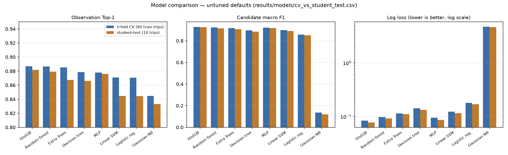
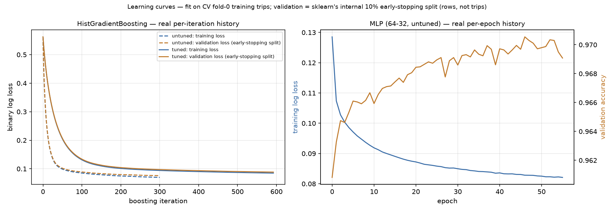

# 3 — Candidate classifiers: comparison and selection

Owner: **B**. Every number comes from `results/models/` and is regenerated by
the commands in §3.6. Phase-1 models use **default (untuned) parameters**;
tuning is §4.

## 3.1 Problem framing and protocol

Each GPS observation has a shortlist of ≈ 8–15 candidate arcs (§2). Every
(observation, candidate) pair becomes one row with 18 trip-relative features
(`pathsnap/config.py::FEATURE_NAMES`) and a binary target: 1 if the candidate
is the reference arc, 0 otherwise, ignored if the observation's label is
low-confidence or its reference arc is not a candidate. The classifier's
probability ranks the candidates of each observation; the top-ranked arc is the
classifier-only prediction and the probabilities become HMM emissions (§5).

| Item | Value | Source |
|---|---|---|
| Training data | 80 train trips, 208,417 observations, 1,732,459 rows (182,884 positive, 1,402,460 negative, 147,115 ignored) | `results/models/dataset_summary.json` |
| Validation | GroupKFold(5) **by trip**; no trip in two folds | `results/models/cv_splits.csv` |
| Imbalance | fit set only: all positives + 3 negatives per positive; evaluation on full candidate sets | `pathsnap/models.py::subsample_negatives` |
| Scaling | `StandardScaler` inside the pipeline (LR, MLP, SVM) → fit on training folds only | `pathsnap/models.py` |
| Student-test | 10 trips, 19,160 observations, 184,703 rows; each model refit once on all 80 train trips | `results/models/student_test_comparison.csv` |
| Evaluator trips | never read | — |

**Metrics.** *Observation Top-1* (primary): share of confidently labelled
observations whose highest-probability candidate is the reference arc; a
missing truth counts as wrong. *Macro F1* and *positive F1* at threshold 0.5
over candidate pairs; *log loss* for probability quality; *strict continuity*
of the classifier-only arc sequence (consecutive arcs share a node). Selection:
CV Top-1 with positive F1 and log loss as guardrails (`docs/EXPERIMENTS.md` §3).

## 3.2 Consolidated comparison

| Model | Family | CV Top-1 (±fold std) | Train-trip Top-1 | CV macro F1 | CV log loss | Student Top-1 | Student macro F1 | Student log loss | Student continuity* | Fit s (80 trips) | Inference µs / candidate |
|---|---|---|---|---|---|---|---|---|---|---|---|
| **HistGradientBoosting** | boosting | **0.887** ± 0.027 | 0.923 | **0.928** | **0.084** | **0.882** | **0.925** | **0.078** | 0.755 | 6.7 | 1.8 |
| Random forest | bagging ensemble | 0.886 ± 0.026 | 0.939 | 0.923 | 0.098 | 0.879 | 0.916 | 0.093 | 0.750 | 86.0 | 2.6 |
| Extra Trees | randomised ensemble | 0.885 ± 0.025 | 0.922 | 0.917 | 0.115 | 0.867 | 0.906 | 0.111 | 0.763 | 43.1 | 5.9 |
| Decision tree | tree | 0.879 ± 0.024 | 0.896 | 0.898 | 0.142 | 0.866 | 0.884 | 0.134 | 0.732 | 6.0 | < 0.1 |
| MLP (64-32) | neural network | 0.878 ± 0.028 | 0.910 | 0.922 | 0.096 | 0.876 | 0.918 | 0.087 | 0.756 | 26.3 | < 0.1 |
| Linear SVM (calibrated) | margin | 0.871 ± 0.025 | 0.871 | 0.898 | 0.123 | 0.845 | 0.891 | 0.116 | 0.721 | 2.6 | < 0.1 |
| Logistic regression | linear / probabilistic | 0.871 ± 0.025 | 0.871 | 0.857 | 0.179 | 0.844 | 0.851 | 0.169 | 0.721 | 0.5 | < 0.1 |
| Gaussian Naive Bayes | probabilistic | 0.845 ± 0.032 | 0.844 | 0.137 | 4.746 | 0.833 | 0.121 | 4.666 | 0.672 | 0.1 | < 0.1 |
| Nearest-road baseline | rule-based | 0.575 ± 0.020 | — | — | — | 0.564 | — | — | — | — | — |

\* Strict continuity of the **classifier-only** arc sequence, mean over the 10
student-test trips; the HMM's continuity is §5. Sources:
`results/models/model_comparison.csv` (CV), `student_test_comparison.csv`,
`cv_vs_student_test.csv`. CV fit times for the MLP and SVM were measured while
another job shared the CPU; the student-test fit times above were measured alone.

**Selection: HistGradientBoosting.** It has the best CV Top-1 *and* the best CV
macro F1 and log loss; on student-test it is again first on all three. Random
forest is 0.0003 behind on CV Top-1 — far inside the fold standard deviation
(≈ 0.026), so the headline alone cannot separate them. The guardrails can: HGB
has better-calibrated probabilities (the HMM consumes them), a smaller
train/validation gap (0.036 vs 0.052), a 13× faster fit and a smaller artifact.
The CV ranking largely carries over to the unseen student-test trips
(`cv_vs_student_test.csv`): the top two and bottom three are identical, and the
only movement is in the middle (the MLP rises from 5th to 3rd). This is
evidence that the choice is not an artefact of fold noise.



## 3.3 Per-model analysis

Each subsection answers the seven compulsory questions: (1) suitability,
(2) strengths/limitations, (3) hyperparameters, (4) loss/objective,
(5) student-test performance, (6) Top-1/macro F1/log loss, (7) over/underfitting.

### HistGradientBoosting (selected)

1. **Suitability:** the signal lives in interactions (a 12 m offset is fine
   when the heading matches, suspicious when it does not); boosted trees learn
   these without manual feature crosses and are fast on 0.7 M rows.
2. **Strengths:** best accuracy and calibration, histogram binning makes it the
   fastest ensemble. **Limitations:** less interpretable than one tree; more
   hyperparameters (tuned in §4).
3. **Hyperparameters:** learning rate 0.08, ≤ 300 iterations, 31 leaves,
   min 40 samples/leaf, L2 1.0, early stopping on a 10% internal split.
4. **Objective:** binary log loss, gradient boosting in function space.
5. **Student-test:** Top-1 0.882, macro F1 0.925, log loss 0.078.
6. **CV:** Top-1 0.887 ± 0.027, macro F1 0.928, positive F1 0.874, log loss 0.084.
7. **Fit:** mild overfitting — train-trip Top-1 0.923 vs 0.887 held out. The
   real per-iteration curves (§3.4) show training and validation loss falling
   together with a small, stable gap; early stopping never triggered (all 300
   iterations used), so the model is not overtrained.

### Random forest

1. **Suitability:** robust non-linear baseline; averages many decorrelated
   trees, which suits noisy GPS features.
2. **Strengths:** near-best Top-1, little tuning needed. **Limitations:**
   slowest fit (86 s), largest model, probabilities less sharp than HGB.
3. **Hyperparameters:** 300 trees, unlimited depth, min 5 samples/leaf,
   √features per split, balanced-subsample class weights.
4. **Objective:** Gini impurity per split; bagging.
5. **Student-test:** Top-1 0.879, macro F1 0.916, log loss 0.093.
6. **CV:** Top-1 0.886, macro F1 0.923, log loss 0.098.
7. **Fit:** the clearest **overfitting** of all models — train-trip Top-1
   0.939 vs 0.886 held out — because unlimited-depth trees memorise trips.

### Extra Trees

1. **Suitability:** like RF but with random split thresholds — a cheaper,
   more regularised ensemble.
2. **Strengths:** half RF's fit time; smaller train/held-out gap.
   **Limitations:** weakest calibration of the ensembles; the largest
   CV → student-test drop among them (0.885 → 0.867).
3. **Hyperparameters:** as RF (300 trees, min 5/leaf, √features), balanced weights.
4. **Objective:** Gini impurity with randomised thresholds.
5. **Student-test:** Top-1 0.867, macro F1 0.906, log loss 0.111.
6. **CV:** Top-1 0.885, macro F1 0.917, log loss 0.115.
7. **Fit:** moderate overfitting (0.922 vs 0.885).

### Decision tree

1. **Suitability:** the interpretable building block of the ensembles; shows
   what ensembling adds.
2. **Strengths:** readable rules, near-instant inference. **Limitations:** high
   variance, coarse step-shaped probabilities (log loss 0.142).
3. **Hyperparameters:** max depth 12, min 20 samples/leaf, balanced weights.
4. **Objective:** greedy Gini impurity.
5. **Student-test:** Top-1 0.866, macro F1 0.884, log loss 0.134.
6. **CV:** Top-1 0.879, macro F1 0.898, log loss 0.142.
7. **Fit:** small gap (0.896 vs 0.879) thanks to the depth/leaf limits;
   ensembling adds ≈ 0.8 points of Top-1.

### MLP (64-32)

1. **Suitability:** learns smooth non-linear interactions; the neural-network
   family of the brief.
2. **Strengths:** good calibration (log loss 0.096 CV, 0.087 student) and the
   smallest CV → student-test drop of all models (0.878 → 0.876). **Limitations:** needs scaling,
   seed-sensitive, slow on CPU.
3. **Hyperparameters:** two ReLU layers (64, 32), Adam lr 1e-3, L2 α 1e-4,
   ≤ 200 epochs, early stopping (patience 8).
4. **Objective:** binary log loss.
5. **Student-test:** Top-1 0.876, macro F1 0.918, log loss 0.087.
6. **CV:** Top-1 0.878, macro F1 0.922, log loss 0.096.
7. **Fit:** moderate gap (0.910 vs 0.878). The real per-epoch history (§3.4):
   training loss falls smoothly; validation accuracy plateaus ≈ 0.970 and
   early stopping halts at epoch 56.

### Linear SVM (calibrated)

1. **Suitability:** maximum-margin linear alternative.
2. **Strengths:** fast, stable. **Limitations:** a single hyperplane; scores
   need Platt calibration to become probabilities.
3. **Hyperparameters:** C = 1, balanced weights, sigmoid calibration with 3
   internal folds.
4. **Objective:** squared hinge + L2, then Platt scaling.
5. **Student-test:** Top-1 0.845, macro F1 0.891, log loss 0.116.
6. **CV:** Top-1 0.871, macro F1 0.898, log loss 0.123.
7. **Fit:** **underfitting** — identical train-trip and held-out Top-1 (0.871);
   a linear boundary cannot express "distance matters unless the heading is
   wrong". It ties with logistic regression for the largest CV → student-test drop (−2.6 points).

### Logistic regression

1. **Suitability:** interpretable, probabilistic linear baseline.
2. **Strengths:** trains in 0.5 s; coefficients are readable. **Limitations:**
   linear boundary; balanced class weights on top of the 1:3 fit ratio push
   probabilities up, so precision, F1 and log loss suffer at threshold 0.5
   while ranking (Top-1) is unaffected.
3. **Hyperparameters:** C = 1 (L2), lbfgs, ≤ 2000 iterations, balanced weights.
4. **Objective:** L2-regularised binary log loss.
5. **Student-test:** Top-1 0.844, macro F1 0.851, log loss 0.169.
6. **CV:** Top-1 0.871, macro F1 0.857, log loss 0.179.
7. **Fit:** **underfitting** (0.871 train vs 0.871 held out), like the SVM.

### Gaussian Naive Bayes

1. **Suitability:** the probabilistic baseline that tests the independence
   assumption.
2. **Strengths:** instant to train. **Limitations:** distance, distance ratio
   and rank encode the same evidence; NB counts it repeatedly and pushes
   probabilities to 0/1.
3. **Hyperparameters:** `var_smoothing` 1e-9.
4. **Objective:** none iterative — per-class Gaussian maximum likelihood + Bayes' rule.
5. **Student-test:** Top-1 0.833, macro F1 0.121, log loss 4.666.
6. **CV:** Top-1 0.845, macro F1 0.137, log loss 4.746.
7. **Fit:** high bias, no overfitting. **Lesson:** reasonable *ranking*
   (Top-1) but useless *probabilities* — disqualifying for HMM emissions.

## 3.4 Learning curves (real histories only)

Only HistGradientBoosting and the MLP expose genuine per-iteration histories;
no curve is drawn for the other models. Both were fit on the training trips of
CV fold 0; the validation series is scikit-learn's internal 10% early-stopping
split (random rows, not held-out trips), so it is slightly optimistic and is
used here only to show convergence and the train/validation gap. Losses are on
the 1:3 subsampled fit distribution, so their absolute values are not
comparable with the CV log loss in §3.2.



Source: `results/models/learning_curves.json` (HGB untuned: final train loss
0.070 vs validation 0.076 after 300 iterations; MLP: 56 epochs, best
validation accuracy 0.971).

## 3.5 Feature contribution (summary of T13)

Same model and folds, only the columns change (`results/models/feature_ablation.csv`):
distance only 0.567 → local group 0.879 → + relative 0.880 → full 0.887 CV
Top-1. Removing the two heading features costs 0.241 Top-1 — the single most
important signal. Permutation importance (`feature_importance.csv`) ranks
`abs_heading_diff`, `log_distance`, `projection_ratio`, `distance_ratio_best`.

## 3.6 Reproduction

```bash
python3 scripts/02_build_dataset.py --data-root ./data
python3 scripts/02_build_dataset.py --data-root ./data --partitions student_test --out cache/student_test.npz
python3 scripts/03_train_models.py --folds 5 --profile full --out-dir results/models
python3 scripts/03b_feature_ablation.py --model hist_gradient_boosting --folds 5 --repeats 3
python3 scripts/04_tune.py --trials 40 --folds 5           # §4
python3 scripts/04b_student_test_eval.py --data-root ./data
python3 scripts/04c_model_figures.py
```
