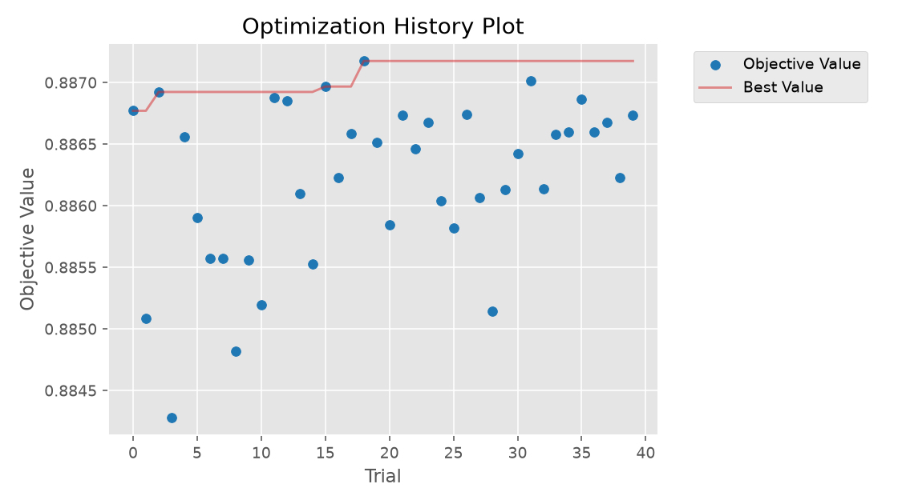
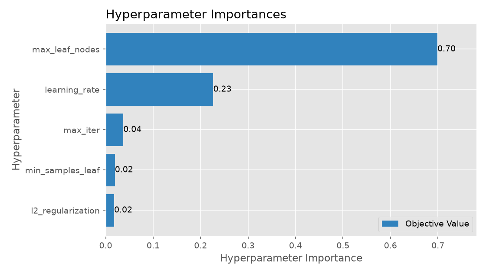

# 4 — Bayesian hyperparameter optimisation

Owner: **B**. Sources: `results/optuna/` (study, trials, best parameters,
plots) and `results/models/tuned_vs_untuned.csv`.

## 4.1 Set-up

| Item | Value |
|---|---|
| Model tuned | HistGradientBoosting (the model selected in §3) |
| Library / sampler | Optuna 5.1, TPE sampler, seed 42 |
| Objective (maximised) | CV observation Top-1, pooled out-of-fold — the same selection metric as §3 |
| Validation | GroupKFold(5) by trip on the 80 train trips; identical folds for every trial |
| Data per fold | fit: all positives + 3 negatives per positive; evaluate: full candidate sets |
| Trials | 40 (≥ 30 required); trial 0 = the untuned default, so the baseline is inside the study |
| Recorded per trial | Top-1, fold mean/std, macro F1, positive F1, log loss, fit and wall time; failures kept (0 failed) |
| Not used | student-test (reported only), evaluator trips (never read) |

**Search space** (`scripts/04_tune.py::SPACES`):

| Parameter | Range | Scale | Default |
|---|---|---|---|
| `learning_rate` | 0.01 – 0.3 | log | 0.08 |
| `max_iter` (trees) | 100 – 600 | int | 300 |
| `max_leaf_nodes` | 15 – 127 | int | 31 |
| `min_samples_leaf` | 20 – 200 | int | 40 |
| `l2_regularization` | 1e-8 – 10 | log | 1.0 |

**Cost:** 40 trials × 5 folds = 200 model fits, **34.9 min** wall clock
(mean 52 s per trial) on one laptop CPU (`results/optuna/best_params.json`).

## 4.2 Results



- Every trial lands between **0.8843 and 0.8872** CV Top-1 — a spread of
  0.003, about one-ninth of the fold standard deviation (0.027).
- Best: **trial 18**, CV Top-1 **0.8872** — learning rate 0.0223, 592 trees,
  19 leaves, min 97 samples/leaf, L2 3.69: many small, strongly regularised trees.
- Only 7 of the 39 non-default trials match or beat the default.
- fANOVA importance (`results/optuna/param_importances.json`):
  `max_leaf_nodes` 0.76, `learning_rate` 0.11, `max_iter` 0.08,
  `min_samples_leaf` 0.03, `l2_regularization` 0.02. Tree size is the only
  setting that matters within this range.



## 4.3 Tuned vs untuned

Same features, candidates, labels and metrics; CV on identical folds; student-test
from one refit on all 80 train trips (`results/models/tuned_vs_untuned.csv`).

| Configuration | Partition | Top-1 | Macro F1 | Positive F1 | Log loss | Fit s | Inference µs / cand. |
|---|---|---|---|---|---|---|---|
| Untuned | CV (5 folds) | 0.8868 | **0.9283** | **0.8740** | **0.0838** | 22 (5 folds) | — |
| Tuned (trial 18) | CV (5 folds) | **0.8872** | 0.9274 | 0.8726 | 0.0847 | 53 (5 folds) | — |
| Untuned | student-test | **0.8818** | **0.9249** | **0.8663** | **0.0775** | 7.5 | **2.0** |
| Tuned (trial 18) | student-test | 0.8775 | 0.9214 | 0.8601 | 0.0797 | 15.4 | 3.5 |

**Decision: keep the untuned configuration** (`results/models/tuned_vs_untuned_decision.json`).
The rule follows `docs/EXPERIMENTS.md` §3 — select on CV Top-1 with positive
F1 and log loss as guardrails — and is applied to **CV only**:

- the tuned Top-1 gain (+0.0004) is ≈ 1/65 of the fold standard deviation;
- both guardrails get slightly worse (positive F1 −0.0014, log loss +0.0009);
- the tuned model is 2.4× slower to fit and 1.8× slower at inference.

The student-test rows were *not* used to decide; they agree with the decision
(tuned −0.0043 Top-1 on unseen trips). The exported artifact is therefore
unchanged (`artifacts/model.joblib`, version `6c229c610200`), and the exporter
only applies Optuna parameters when this decision file says
`"export tuned"`.

## 4.4 Interpretation

The default configuration was already on the plateau of the Top-1 surface:
40 trials of TPE could not move CV Top-1 by more than fold noise. The limit is
not the boosting hyperparameters but the information in the per-observation
features — the remaining ≈ 11% of errors are junctions, parallel carriageways
and two-way arcs that one observation cannot disambiguate. That is the HMM's
job (§5) and the main lever for further gains, together with richer sequence
features. Reporting a null tuning result is deliberate: the protocol records
the search, its cost and the decision, and does not cherry-pick a trial.

## 4.5 Reproduction

```bash
python3 scripts/04_tune.py --trials 40 --folds 5        # results/optuna/
python3 scripts/04b_student_test_eval.py --data-root ./data
python3 scripts/06_export_artifacts.py                  # honours the T24 decision
```
