<div class="title-page" markdown="1">

# PathSnap: Distributed Map-Matching and Route Reconstruction

## Technical Report

**UE24CS352A Machine Learning — Hackathon · Group 8**

| SRN | Name |
|---|---|
| PES2UG25CS801 | Abhishek B Khanapur |
| PES2UG24CS514 | Sphoorthi Pulipati |
| PES2UG24CS547 | T S Sathya Kiran |
| PES2UG24CS502 | Siddhesh Dattatray Koditkar |

**Repository:** https://github.com/Siddhesh249/ML-HACKATHON-Group-8

</div>

## 1. Overview

PathSnap reconstructs the road route a vehicle actually drove from a noisy 1 Hz
GPS trace and the trip's own road network. The pipeline has two learned stages:

1. a **candidate classifier** scores every (GPS observation, nearby road arc)
   pair, and
2. an **HMM decoded with Viterbi** turns these independent scores into one
   connected route that respects the road network.

The system is deployed on two laptops: a FastAPI service (Laptop 1) holds the
model, the decoder, the road networks and the reference routes and scores every
prediction server-side; a Streamlit UI (Laptop 2) selects a trip and displays the
result. The reference route is never available to the prediction path or the UI.

**Headline results** on the 10 student-test trips (never used for training or for
choosing any setting; mean per trip):

| | Classifier only | Classifier + HMM (final) |
|---|---|---|
| Observation Top-1 accuracy | 0.900 | **0.930** |
| Strict route continuity | 0.755 | **0.906** |
| Sequence LCS F1 | 0.772 | **0.933** |

Every number in this report is produced by a script in the repository and stored
under `results/`; the reproduction commands are in the Appendix.

---

## 2.2 Dataset Understanding and Exploratory Data Analysis

### Data and partitions

Each trip is a folder of four headerless text files: `.track` (longitude,
latitude, timestamp in seconds), `.nodes` (longitude, latitude; node ID = row
index), `.arcs` (from-node, to-node; arc ID = row index) and `.route` (the
reference arc sequence in driving order). A GPS row does not correspond to a
node, arc or route row — the link is geometric.

| Partition | Trips | GPS points | Used for |
|---|---|---|---|
| Train | 80 | 208,417 | EDA, fitting, cross-validation, model selection, all tuning |
| Student-test | 10 | 19,160 | EDA, held-out evaluation only |
| Evaluator | 10 | — | final demonstration only; never read during development |

**Partition used per analysis:** the inventory, missing-value and network
analyses use all 90 provided trips (train + student-test); candidate settings and
label policy were chosen on train only, with student-test reported as a check;
all models and decoder settings were selected on train.

### 1. How did we preprocess the data?

1. **Load and validate** every trip (`pathsnap/io.py`): files present, column
   counts, finite coordinates within lon/lat range, arc endpoints and route IDs
   inside the node/arc ranges.
2. **Project to metres.** Longitude/latitude are angles, so every trip is
   projected to a local equirectangular frame centred on its own track (error
   below 0.5% at trip scale); all distances below are in metres.
3. **Smooth the GPS trace** with a centred 5-point moving average and derive
   heading and speed from the smoothed points before and after each observation
   — raw 1 Hz bearings are dominated by jitter.
4. **Generate candidates.** Each arc is sampled every 5 m into a KD-tree; every
   GPS point gets up to 15 arcs within 60 m (fallback 100 m, then 150 m), ranked
   by exact point-to-segment distance.
5. **Create labels from the reference route.** Each GPS point is labelled with
   the nearest reference-route arc if it lies within 30 m; farther points carry
   no label. Points whose true arc is not among the candidates are excluded from
   training but still count as errors in evaluation.
6. **Build the training rows.** One row per (point, candidate) with 18 features
   and a binary target (1 = this candidate is the reference arc). The 80 train
   trips give 1,732,459 rows (182,884 positive, 1,402,460 negative, 147,115
   unlabelled) — `results/models/dataset_summary.json`.

### Missing-value and data-quality analysis

Source: `results/eda/quality_checks.csv`, `results/eda/summary.json` (all 90 trips).

| Check | Result |
|---|---|
| Trips with all four files | 90 / 90 |
| Non-finite or out-of-range GPS rows | **0** |
| GPS rows at (0, 0) | 0 |
| Repeated or decreasing timestamps | 0 |
| Steps exactly 1 s apart | 96.7% (p99 gap 3 s) |
| Trips with a gap > 30 s | 30 (largest gap 153,064 s ≈ 42.5 h) |
| Raw step speed > 55 m/s (GPS jumps) | 966 steps in 28 trips |
| Zero-length / self-loop / duplicate arcs | 106 / 24 / 1,903 (all trips) |
| Points without a label (> 30 m from the reference route) | 25,365 of 208,417 train points |

There are no missing values at row level; the data problems are structural —
long time gaps, GPS jumps, degenerate arcs, fragmented networks and imperfect
reference routes — and each is handled explicitly (gap reset in the HMM,
smoothing, guarded geometry, confidence-filtered labels).

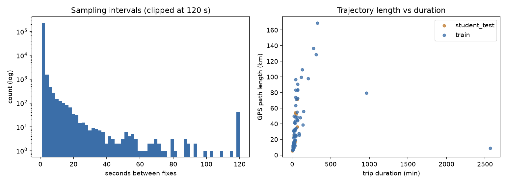

*Figure 1 — Sampling intervals (left, log scale) and GPS path length vs trip
duration (right), all 90 trips.*

### 2. What patterns did we observe?

- **Every trip is a different place.** Trip centroids span several continents
  and networks range from 299 to 155,003 nodes (Figure 2), so absolute
  coordinates and node IDs cannot be used as features.
- **Trips vary widely** — 262 to 19,313 GPS points and 5.5 to 168.9 km of path
  (Figure 3).
- **Arcs are straight chords** with median length 25.6 m but up to 9.3 km, so a
  point can be close to an arc while far from both endpoints; candidates must be
  searched along the arc, not only at its nodes (Figure 5).
- **Networks are fragmented:** median 19 weakly connected components per trip,
  and 95% of arcs have a reverse twin (two-way roads), which matters for
  direction (Figure 4).
- **GPS lies close to the reference route:** median distance 5.6 m, 88.8% of
  points within 30 m (Figure 6); points far from the route are mostly parked
  vehicles or one systematically offset trip.
- **Reference routes are not perfect:** 11 routes have breaks between
  consecutive arcs and 2 train trips (`00000033`, `00000054`) have unreliable
  references (coverage 29% and 11%) — Figure 8.

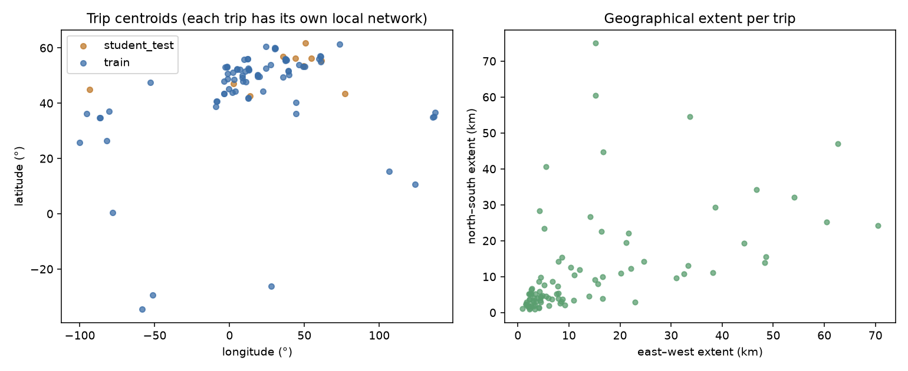

*Figure 2 — GPS coordinate distribution: trip centroids by partition (left) and
geographical extent per trip (right), all 90 trips.*

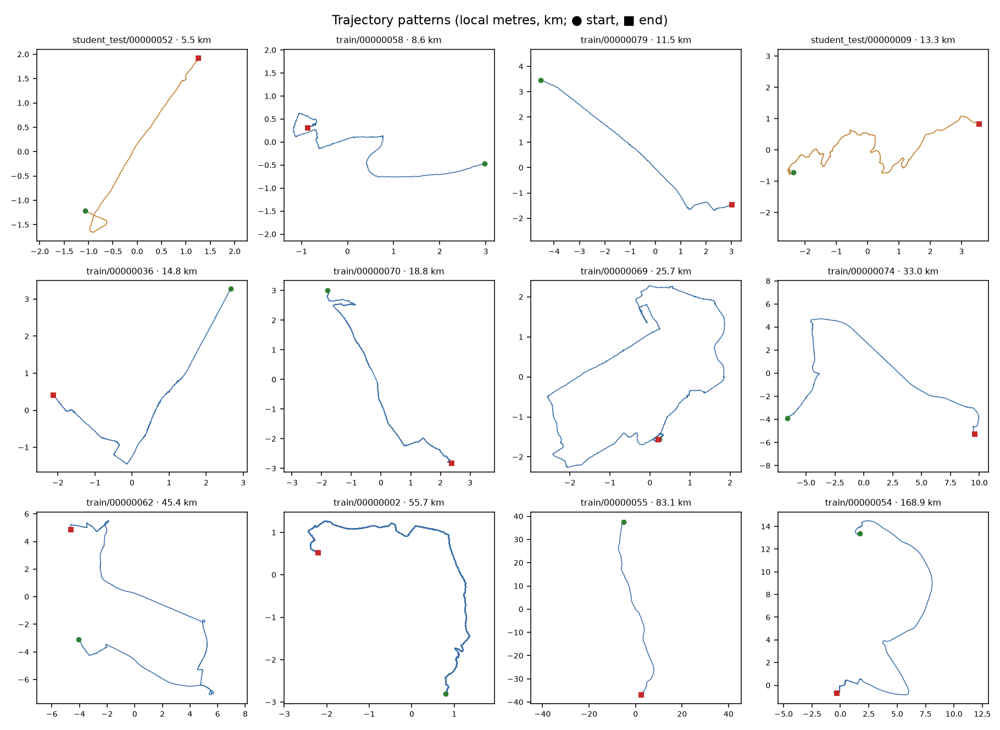

*Figure 3 — GPS trajectory plots for 12 trips spanning the length range (local
metres; ● start, ■ end).*

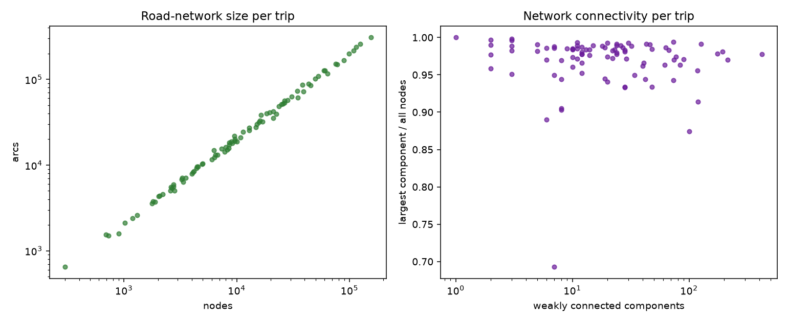

*Figure 4 — Road-network size (left) and connectivity (right) per trip.*

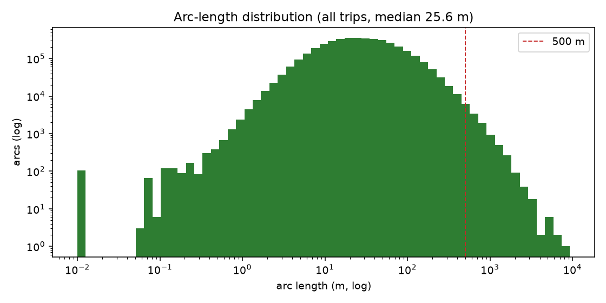

*Figure 5 — Arc-length distribution across all trips (log–log).*

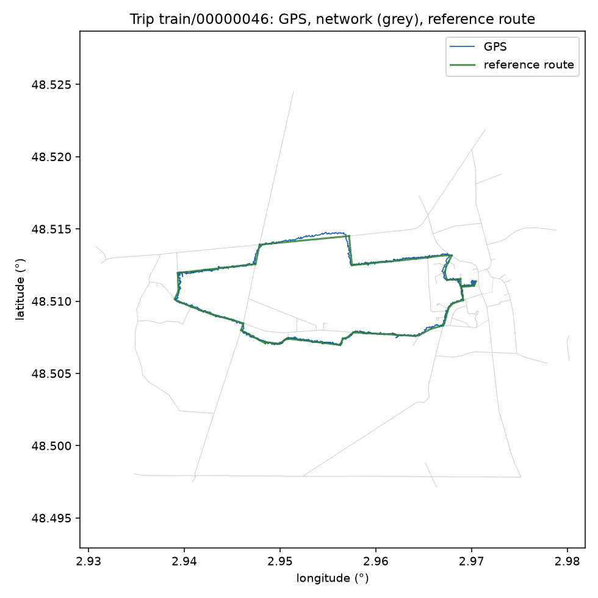

*Figure 6 — Road-network visualisation: trip-local network (grey), GPS trace
(blue) and reference route (green), train trip `00000046`.*

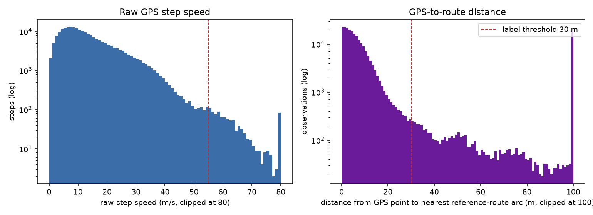

*Figure 7 — Raw step speed (left) and distance from each GPS point to the
reference route with the 30 m label threshold (right).*

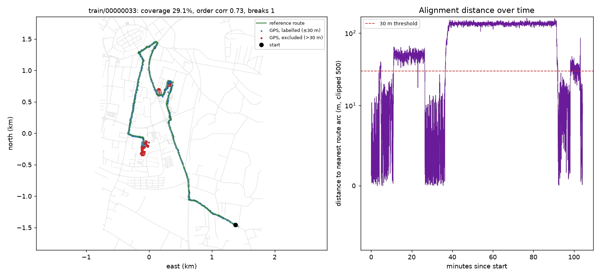

*Figure 8 — Label visual check, train trip `00000033`: the vehicle is parked
≈ 120 m off the network for ≈ 55 min; those points correctly receive no label.*

**Candidate generation** (train for the choice, student-test as a check;
`results/eda/candidate_sweep.csv`): with up to 15 candidates within 60 m the
reference arc is missing for only **0.092%** of labelled train points (0.032%
student-test), with 8.7 candidates per point on average. The miss rate is driven
by the number of candidates kept, not the radius (Figure 9).

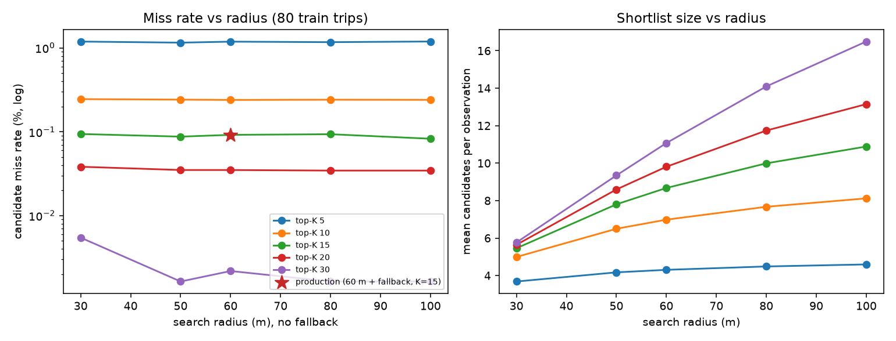

*Figure 9 — Candidate miss rate and shortlist size vs search radius and top-K
(train).*

**Folium map.** Figure 10 shows an interactive Folium map of train trip
`00000046` with GPS observations, the trip-local road network and the reference
route as toggleable layers (`results/maps/train_00000046_reference.html`).

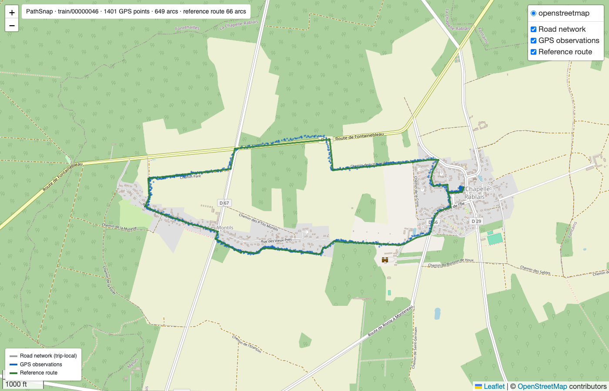

*Figure 10 — Folium map (screenshot): GPS observations (blue), reference route
(green), road network, layer control and legend.*

### Which features did we extract and why?

All 18 features are computed per (observation, candidate) pair and are relative
to the trip and the candidate set (`pathsnap/features.py`).

| Group | Features | Why |
|---|---|---|
| Local geometry (10) | log distance to arc, projection ratio along the arc, absolute and cosine heading difference, log arc length, log distance to arc start/end, from/to node degree, reciprocal-arc flag | The closest arc is usually right, but not at junctions or on parallel and two-way roads; heading separates opposite carriageways; position and junction degree describe where on the road the point is |
| Relative (3) | distance ratio to the closest candidate, candidate rank, candidate count | Makes the score depend on the competing candidates, not on absolute scale |
| Temporal / graph (5) | log network distance from the previous point's nearest candidate, same-arc-as-previous flag, network-vs-GPS displacement mismatch, log speed, log time gap | Encodes reachability and continuity that distance alone cannot see; the mismatch catches impossible jumps |

No raw coordinates, node IDs, arc IDs or target-derived values are used; the
"previous point" features use the previous point's *nearest* candidate, never the
true arc. Distances and lengths are log-transformed because they are heavy-tailed.

**Feature ablation** (same model and folds, only the columns change;
`results/models/feature_ablation.csv`): distance alone gives CV Top-1 0.567,
local geometry 0.879, adding relative features 0.880, all 18 features **0.887**.
Removing only the two heading features drops Top-1 to **0.646** — direction of
travel is the single most important signal (Figures 11–12).

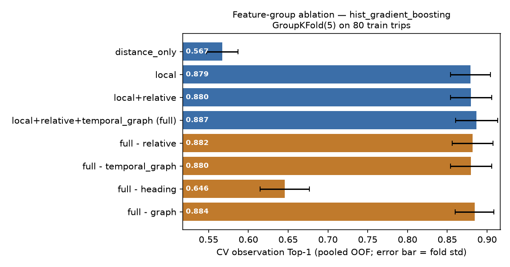

*Figure 11 — Feature-group ablation (HistGradientBoosting, 5-fold
trip-grouped CV, train).*

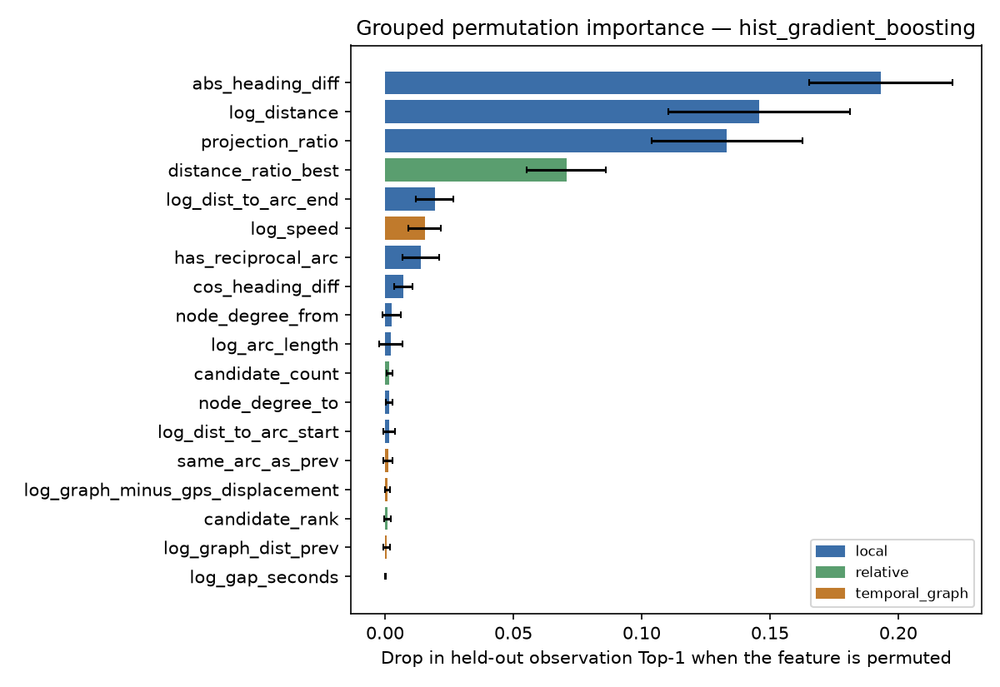

*Figure 12 — Permutation importance: drop in held-out Top-1 when one feature is
shuffled (train, 5 folds × 3 repeats).*

---

## 3. Model Experimentation and Comparison

**Protocol.** Eight model families were trained on the same rows. Validation is
5-fold **GroupKFold by trip** on the 80 train trips, so no trip appears in both
training and validation. In each training fold all positives are kept with 3
random negatives per positive; validation always uses the full candidate sets.
Scaling is fitted inside the pipeline (training folds only). For student-test,
each model is refit once on all 80 train trips. Default (untuned)
hyperparameters are used here; tuning is §4.

**Metrics.** *Observation Top-1*: the share of labelled GPS points whose
highest-probability candidate is the reference arc (the map-matching decision;
primary selection metric). *Macro F1* and *log loss* over candidate pairs at
threshold 0.5. *Route continuity*: share of consecutive predicted arcs that share
a node (classifier-only argmax sequence). Inference time is per candidate pair.

### 3.1 Overall model comparison

| Model | Algorithm family | Key configuration | CV macro F1 | Top-1 accuracy (CV / student-test) | Route continuity (student-test, classifier only) | Student-test macro F1 | Log loss (CV / student-test) | Inference time (µs per candidate) |
|---|---|---|---|---|---|---|---|---|
| **HistGradientBoosting** | Boosting | lr 0.08, ≤ 300 trees, 31 leaves, min leaf 40, L2 1.0, early stopping | **0.928** | **0.887 / 0.882** | 0.755 | **0.925** | **0.084 / 0.078** | 1.8 |
| Random forest | Bagging ensemble | 300 trees, unlimited depth, min leaf 5, √features, balanced weights | 0.923 | 0.886 / 0.879 | 0.750 | 0.916 | 0.098 / 0.093 | 2.6 |
| Extra Trees | Randomised ensemble | 300 trees, min leaf 5, √features, balanced weights | 0.917 | 0.885 / 0.867 | 0.763 | 0.906 | 0.115 / 0.111 | 5.9 |
| Decision tree | Tree | max depth 12, min leaf 20, balanced weights | 0.898 | 0.879 / 0.866 | 0.732 | 0.884 | 0.142 / 0.134 | < 0.1 |
| MLP | Neural network | 2 ReLU layers (64, 32), Adam lr 1e-3, α 1e-4, early stopping | 0.922 | 0.878 / 0.876 | 0.756 | 0.918 | 0.096 / 0.087 | < 0.1 |
| Linear SVM | Kernel / margin | C 1, balanced weights, Platt calibration (3 folds) | 0.898 | 0.871 / 0.845 | 0.721 | 0.891 | 0.123 / 0.116 | < 0.1 |
| Logistic regression | Linear / probabilistic | C 1 (L2), lbfgs, balanced weights | 0.857 | 0.871 / 0.844 | 0.721 | 0.851 | 0.179 / 0.169 | < 0.1 |
| Gaussian Naive Bayes | Probabilistic | var_smoothing 1e-9 | 0.137 | 0.845 / 0.833 | 0.672 | 0.121 | 4.746 / 4.666 | < 0.1 |
| Nearest-road baseline | Rule-based | argmin distance | N/A — no probabilities, so no threshold-based F1 | 0.575 / 0.564 | N/A — not decoded | N/A — no probabilities | N/A — no probabilities | N/A |

Sources: `results/models/model_comparison.csv` (CV),
`results/models/student_test_comparison.csv`,
`results/models/cv_vs_student_test.csv`. The continuity of the final system with
the HMM is 0.906 (§5).

**Selection: HistGradientBoosting.** It has the best CV Top-1, CV macro F1 and
CV log loss, and is again first on all three on student-test. Random forest is
0.0003 behind on CV Top-1, far inside the fold standard deviation (≈ 0.026), so
the headline alone cannot separate them; HistGradientBoosting wins on the
guardrails — better-calibrated probabilities (the HMM consumes them), a smaller
train/validation gap (0.036 vs 0.052), a 13× faster fit and a smaller model.
The CV ranking largely carries over to the unseen student-test trips: the top two
and bottom three are identical.

### 3.2 Per-model analysis

#### Model 1 — HistGradientBoosting (selected)

**A1. Why suitable?** The useful signal lies in feature interactions (a 12 m
offset is normal when the heading matches and suspicious when it does not);
boosted trees learn such interactions directly and train quickly on ~0.7 M rows.
**A2. Strengths / limitations.** Best accuracy and calibration and the fastest
ensemble (histogram binning); less interpretable than a single tree and has more
hyperparameters.
**B5. Hyperparameters.** Learning rate 0.08, up to 300 iterations, 31 leaves,
minimum 40 samples per leaf, L2 1.0, early stopping on a 10% internal split.
**B6. Objective.** Binary log loss minimised by gradient boosting.
**C7–8. Student-test.** Top-1 **0.882**, macro F1 **0.925**, log loss **0.078**.
**C9. Fit.** Mild overfitting: Top-1 0.923 on training trips vs 0.887 on held-out
trips. The real per-iteration curves (Figure 15) show training and validation
loss falling together with a small stable gap; early stopping never triggered.

#### Model 2 — Random forest

**A1.** A robust non-linear baseline that averages many decorrelated trees,
well suited to noisy GPS features.
**A2.** Near-best Top-1 with little tuning; slowest to train (86 s), largest
model, and less sharp probabilities than HistGradientBoosting.
**B5.** 300 trees, unlimited depth, minimum 5 samples per leaf, √features per
split, balanced-subsample class weights.
**B6.** Gini impurity at each split; bootstrap aggregation.
**C7–8.** Top-1 0.879, macro F1 0.916, log loss 0.093.
**C9.** The clearest overfitting of all models: 0.939 Top-1 on training trips vs
0.886 held out — unlimited-depth trees memorise training trips.

#### Model 3 — Extra Trees

**A1.** Like random forest but with random split thresholds — a cheaper and more
regularised ensemble.
**A2.** Half the fit time of random forest and a smaller train/held-out gap;
weakest calibration of the ensembles and the largest CV → student-test drop
among them.
**B5.** 300 trees, minimum 5 samples per leaf, √features, balanced weights.
**B6.** Gini impurity with randomised thresholds.
**C7–8.** Top-1 0.867, macro F1 0.906, log loss 0.111.
**C9.** Moderate overfitting: 0.922 on training trips vs 0.885 held out.

#### Model 4 — Decision tree

**A1.** The interpretable building block of the ensembles; it shows what
ensembling adds.
**A2.** Readable rules and near-instant inference; high variance and coarse,
step-shaped probabilities (log loss 0.142).
**B5.** Maximum depth 12, minimum 20 samples per leaf, balanced weights.
**B6.** Greedy Gini impurity.
**C7–8.** Top-1 0.866, macro F1 0.884, log loss 0.134.
**C9.** Small gap (0.896 vs 0.879) thanks to the depth and leaf limits;
ensembling adds about 0.8 points of Top-1.

#### Model 5 — MLP (64-32)

**A1.** Learns smooth non-linear interactions; represents the neural-network
family.
**A2.** Good calibration (log loss 0.096 CV, 0.087 student-test) and the
smallest CV → student-test drop of all models (0.878 → 0.876); needs scaling, is
seed-sensitive and slow on CPU.
**B5.** Two ReLU layers (64, 32), Adam learning rate 1e-3, L2 α 1e-4, up to 200
epochs, early stopping with patience 8.
**B6.** Binary log loss.
**C7–8.** Top-1 0.876, macro F1 0.918, log loss 0.087.
**C9.** Moderate gap (0.910 vs 0.878). The per-epoch history (Figure 15): training
loss falls smoothly, validation accuracy plateaus near 0.970 and early stopping
halts at epoch 56.

#### Model 6 — Linear SVM (calibrated)

**A1.** A maximum-margin linear alternative.
**A2.** Fast and stable; a single hyperplane, and scores must be calibrated
(Platt scaling) to become probabilities.
**B5.** C = 1, balanced weights, sigmoid calibration on 3 internal folds.
**B6.** Squared hinge loss with L2, then Platt scaling.
**C7–8.** Top-1 0.845, macro F1 0.891, log loss 0.116.
**C9.** Underfitting: identical training-trip and held-out Top-1 (0.871); a linear
boundary cannot express "distance matters unless the heading is wrong". It ties
with logistic regression for the largest CV → student-test drop (−2.6 points).

#### Model 7 — Logistic regression

**A1.** An interpretable, probabilistic linear baseline.
**A2.** Trains in 0.5 s and its coefficients are readable; balanced class weights
on top of the 1:3 training ratio push probabilities up, which lowers precision,
F1 and log loss at threshold 0.5 while leaving the ranking (Top-1) unchanged.
**B5.** C = 1 (L2), lbfgs, up to 2,000 iterations, balanced weights.
**B6.** L2-regularised binary log loss.
**C7–8.** Top-1 0.844, macro F1 0.851, log loss 0.169.
**C9.** Underfitting (0.871 on training trips and held out).

#### Model 8 — Gaussian Naive Bayes

**A1.** The probabilistic baseline that tests the independence assumption.
**A2.** Instant to train; distance, distance ratio and rank encode the same
evidence and are counted as independent, which pushes probabilities to 0 or 1.
**B5.** var_smoothing 1e-9.
**B6.** No iterative objective: per-class Gaussian maximum likelihood with Bayes' rule.
**C7–8.** Top-1 0.833, macro F1 **0.121**, log loss **4.666**.
**C9.** High bias, no overfitting. Its ranking (Top-1) is reasonable but its
probabilities are unusable — disqualifying for HMM emissions.

### 3.3 Model visualisations

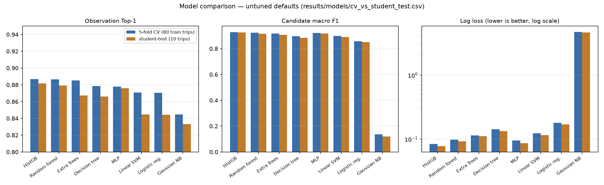

*Figure 13 — Cross-validation vs student-test comparison of all models:
observation Top-1 (left), macro F1 (centre) and log loss (right, log scale).*

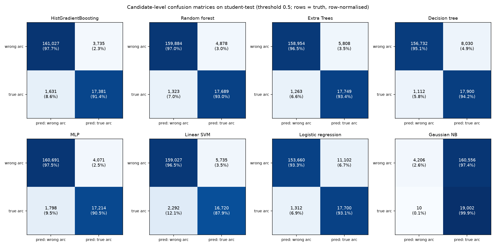

*Figure 14 — Candidate-level confusion matrices on student-test (threshold 0.5,
rows = truth). Gaussian NB predicts almost every candidate as the true arc.*

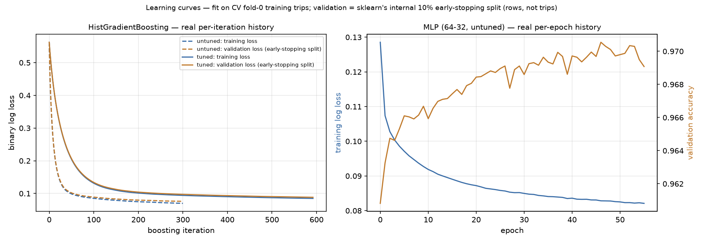

*Figure 15 — Real training histories, only for the two models that produce them
(HistGradientBoosting per boosting iteration, MLP per epoch). No curves are drawn
for models without iteration histories.*

---

## 4. Bayesian Hyperparameter Optimisation (HistGradientBoosting)

**1–2. Search space** (`scripts/04_tune.py`):

| Hyperparameter | Range | Distribution | Default |
|---|---|---|---|
| learning_rate | 0.01 – 0.3 | log-uniform | 0.08 |
| max_iter (trees) | 100 – 600 | integer | 300 |
| max_leaf_nodes | 15 – 127 | integer | 31 |
| min_samples_leaf | 20 – 200 | integer | 40 |
| l2_regularization | 1e-8 – 10 | log-uniform | 1.0 |

**3. Objective.** Maximise CV observation Top-1 (pooled out-of-fold) with 5-fold
GroupKFold by trip on the 80 train trips — the same metric and folds as §3. Every
trial also records macro F1, log loss and fit time.

**4. Trials.** 40 trials with the Optuna TPE sampler (seed 42); trial 0 is the
untuned default, so the baseline is inside the study. 0 failed; total cost 34.9
minutes on one laptop CPU.

**5. Best values.** Trial 18: learning rate 0.0223, 592 trees, 19 leaves, minimum
97 samples per leaf, L2 3.69 — CV Top-1 0.8872 (`results/optuna/best_params.json`).

**6. Did tuning help?** No meaningful gain:

| Configuration | CV macro F1 | Student-test Top-1 | Student-test macro F1 | Log loss (CV / student) | Inference time (µs / candidate) |
|---|---|---|---|---|---|
| Untuned (default) | **0.928** | **0.882** | **0.925** | **0.084 / 0.078** | **2.0** |
| Tuned (trial 18) | 0.927 | 0.878 | 0.921 | 0.085 / 0.080 | 3.5 |

All 40 trials fall between 0.8843 and 0.8872 CV Top-1; the best gain (+0.0004) is
about 1/65 of the fold standard deviation, both guardrails are slightly worse, and
the tuned model is slower and loses 0.004 Top-1 on student-test. Following our
selection rule (CV Top-1 with F1 and log-loss guardrails, decided on CV only), the
**default configuration was kept** (`results/models/tuned_vs_untuned.csv`).
Parameter importance shows tree size (`max_leaf_nodes`, 0.76) is the only setting
that matters within the range; the remaining error is per-point ambiguity that the
HMM, not boosting hyperparameters, must resolve.

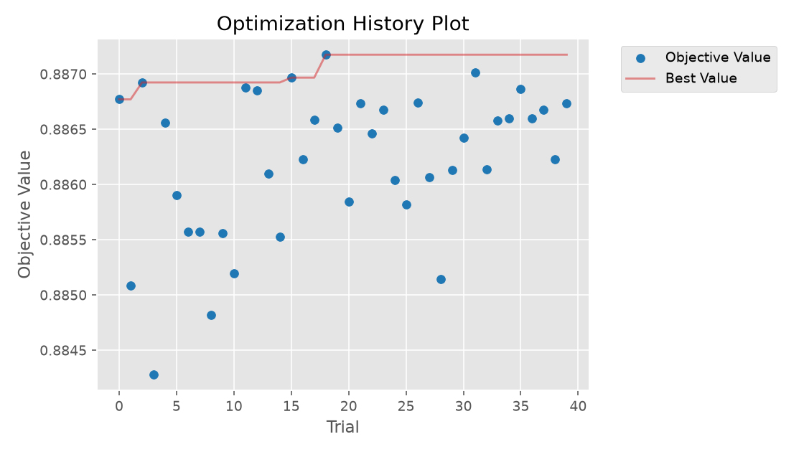

*Figure 16 — Optuna optimisation history (40 trials).*

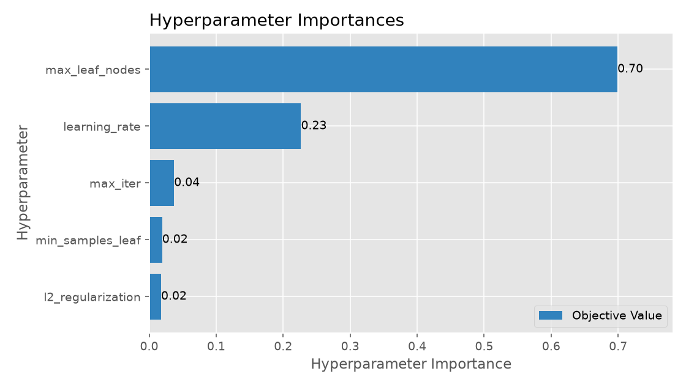

*Figure 17 — Hyperparameter importance (fANOVA).*

---

## 5. HMM and Viterbi Route Reconstruction

**1. Hidden states.** At each GPS observation the hidden state is one of that
observation's candidates (up to 15 arcs). Candidate occurrences are kept per
observation, so the state always maps back to a specific road arc.

**2. Emission probabilities.** The classifier probabilities of an observation's
candidates are normalised to sum to one and used in log space:
`log e_t(j) = log(p_j / Σ_k p_k) − λ·d_j² / (2σ²)`, where `d_j` is the
point-to-arc distance. The selected λ = 0 (the classifier already uses distance).

**3. Transition probabilities.** From candidate *i* at *t−1* to candidate *j* at
*t*, the network distance is the remainder of arc *i* + the shortest path
(directed Dijkstra on a corridor around the trace) + the entered part of arc *j*.
The score is `−|network distance − GPS displacement| / β`, minus a U-turn penalty
if *j* is the reverse of *i*, and each row is normalised with log-sum-exp.
Staying on the same arc uses the progress along the arc; backward progress up to
40 m is treated as GPS jitter. Transitions longer than `max speed × Δt + 300 m`
are infeasible.

**4. Missing candidates and large GPS gaps.** An observation with no candidates
is skipped and reported as unmatched; the chain continues from the previous
observation. If the time gap is at least 60 s the transition is reset to a
uniform distribution, so the decoder is not forced to explain a long gap with a
single path.

**5. Disconnected road segments.** If no path exists or it would need an
impossible speed, the transition is infeasible and Viterbi must choose another
candidate; if every transition from a state is infeasible, that row falls back to
a weak uniform prior instead of killing a possibly correct state.

**Decoder tuning.** A first grid (48 configurations, tuned and reported on
student-test) still lost Top-1 to the classifier. Analysis showed why: at stops,
GPS jitter moves the projection backwards in 18.8% of true same-arc steps
(`results/models/hmm_review_same_arc.json`), the strict forward-only rule made
"stay on this arc" infeasible, and the decoder flipped to the opposite-direction
twin arc — 77–86% of the points it lost on trip `00000077`
(`results/maps/prediction_maps.csv`). The final tuning added the backward
tolerance τ, widened β and the U-turn penalty, **selected the settings on 24 train
trips using out-of-fold classifier probabilities**, and reports on the untouched
student-test trips (`scripts/05d_tune_hmm_v2.py`). τ was decisive: best train
Top-1 0.798 at τ = 0, 0.896 at 25 m, plateau 0.899 from 40 m. Final settings
(`artifacts/hmm_config.json`): τ 40 m, β 5, U-turn penalty 40, λ 0, σ 8, gap
reset 60 s, maximum speed 55 m/s.

**6. Did HMM decoding improve the route?** Yes, on every metric (student-test,
mean per trip, `results/hmm/classifier_vs_hmm.csv`):

| Mode | Top-1 | Strict continuity | LCS F1 | Arc-set F1 | Decode time per trip |
|---|---|---|---|---|---|
| Classifier only | 0.900 | 0.755 | 0.772 | 0.889 | 1.6 ms |
| Classifier + HMM (first tuning) | 0.852 | 0.873 | 0.720 | 0.880 | 1,038 ms |
| **Classifier + HMM (final)** | **0.930** | **0.906** | **0.933** | **0.938** | 476 ms |

| Trip | 00000000 | 00000007 | 00000009 | 00000040 | 00000052 | 00000056 | 00000065 | 00000076 | 00000077 | 00000091 |
|---|---|---|---|---|---|---|---|---|---|---|
| Classifier Top-1 | 0.957 | 0.974 | 0.895 | 0.954 | 0.969 | 0.818 | 0.812 | 0.925 | 0.798 | 0.892 |
| HMM Top-1 | 0.986 | 0.995 | 0.924 | 0.964 | 0.996 | 0.828 | 0.841 | 0.972 | 0.859 | 0.931 |

Pooled over all labelled points, Top-1 rises from 0.882 to 0.912.

**Where HMM decoding did not help.** With the first tuning the HMM *lowered*
Top-1 on 9 of 10 trips while raising continuity — it produced connected but wrong
routes by reversing direction at stops. With the final settings it improves every
trip, but the gain is small on `00000040` (+0.010) and `00000056` (+0.011): those
errors come from parallel carriageways and dense junctions where the classifier's
best and second-best arcs are both connected and plausible, so network
consistency cannot tell them apart. The HMM also costs time — about 0.5 s of
decoding per trip versus milliseconds for the classifier.

---

## 6. Geographical Visualisation Using Folium

Maps are generated from the actual pipeline by `visualisation/make_maps.py`
(`--predict`): the prediction runs exactly as in the API (no reference route),
and only afterwards is the reference loaded to draw and score it. Each map has
the trip-local road network (grey), GPS observations (blue), the reference route
(wide green band), the classifier-only route (orange) and the HMM route (purple)
as separate layers with a layer control, a legend, a scale bar and a title with
the trip's scores. The interactive maps are committed in `results/maps/`.

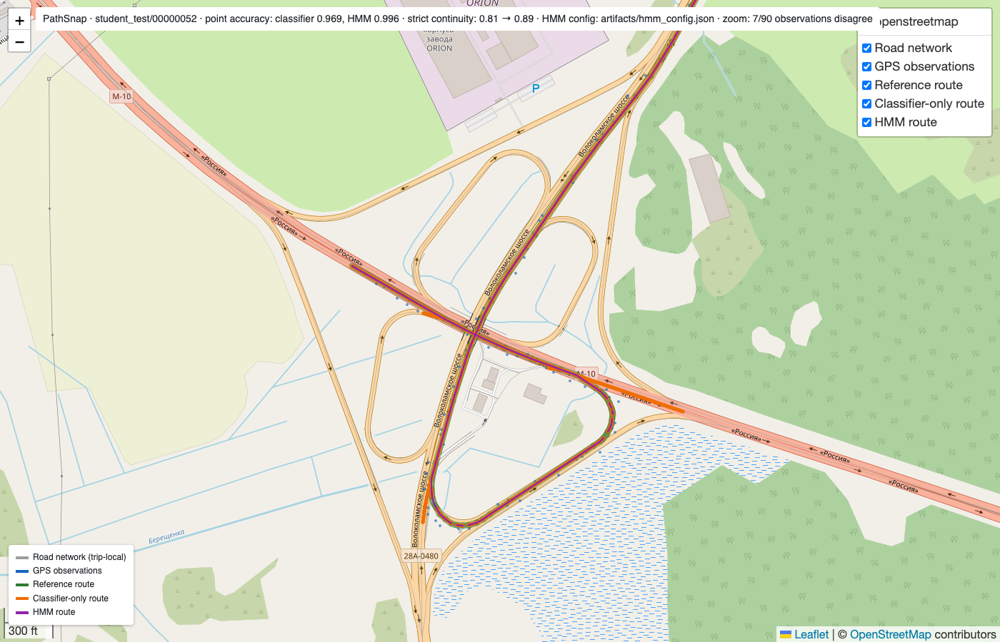

*Figure 18 — Student-test trip `00000052`, zoom on a motorway interchange: the
classifier alone (orange) jumps onto the motorway segments, while the HMM route
(purple) stays on the ramp the vehicle actually used (Top-1 0.969 → 0.996).*

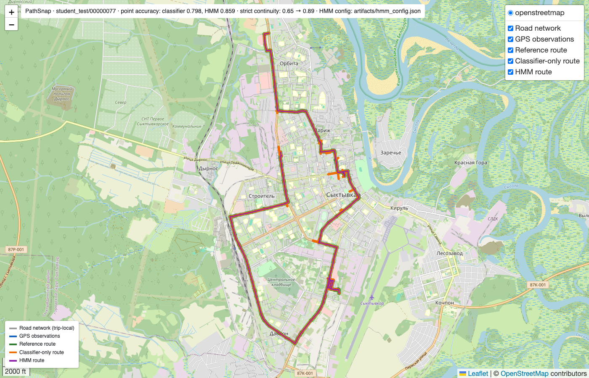

*Figure 19 — Student-test trip `00000077`, full extent: GPS observations,
reference route, classifier-only and HMM routes (Top-1 0.798 → 0.859, continuity
0.65 → 0.89).*

---

## 7. API, UI and Deployment

**Architecture.** Laptop 1 runs the FastAPI service (`backend/`) with the model
artifact, the HMM, the road networks and the reference routes. Laptop 2 runs the
Streamlit UI (`ui/`), which imports no model, data loader or reference route and
talks to the API over HTTP on the same Wi-Fi or hotspot.

| Endpoint | Method | Purpose |
|---|---|---|
| `/health` | GET | ready flag, model name and version, trip count |
| `/version` | GET | API version, git commit, model version |
| `/trips` | GET | the evaluation trips (metadata only, no ground truth) |
| `/predict` | POST | `{"trip_id", "mode": "hmm" or "classifier"}` → metrics, predicted route, stage timings |

The prediction path loads each trip with `load_trip(..., with_route=False)`;
scoring against `.route` happens only after the prediction and only on Laptop 1.
Every request is logged on Laptop 1 (`HTTP POST /predict status=200 …` and
`PREDICT trip=… top1=… continuity=… latency_ms=…`).

**Integration.** All 10 student-test trips pass in both modes through the real
API code path (`results/integration/summary.json`): HMM mode Top-1 0.930,
continuity 0.906; median latency 563 ms, p95 1.67 s, worst 1.85 s on the largest
trip (3,958 points).

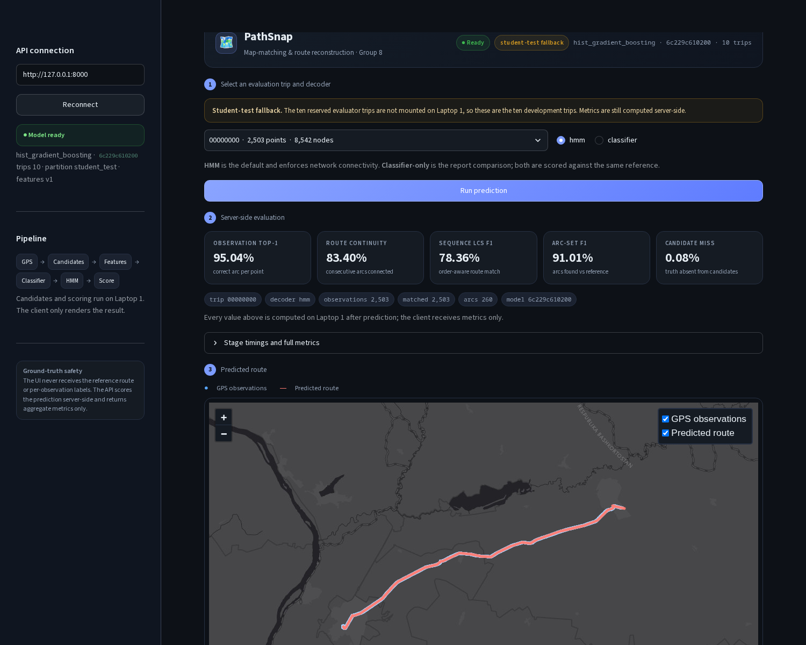

*Figure 20 — Evaluator UI on Laptop 2: trip selection, decoder mode, metric
cards, predicted route on the map and stage timings. (Captured during
integration testing with an earlier decoder configuration; the final numbers are
in §5.)*

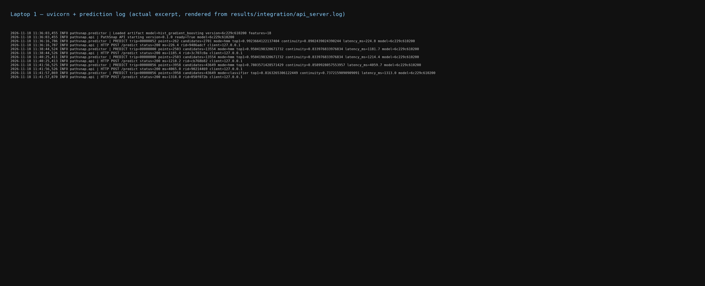

*Figure 21 — API terminal on Laptop 1 showing the received `/predict` requests
and the server-side scores. (Captured during integration testing with an earlier
decoder configuration; the metric values in the log therefore differ from the
final numbers in §5.)*

**Running the demo.** Laptop 1: `make api` (FastAPI on `0.0.0.0:8000`, terminal
kept visible). Laptop 2:
`PATHSNAP_API_URL=http://<Laptop-1-IP>:8000 make ui`, then open
`http://localhost:8501`. Step-by-step instructions and troubleshooting are in the
repository README (§6) and `docs/DEPLOYMENT.md`. The submitted source code is the
code run in the demonstration.

---

## 8. Academic Integrity and AI Assistance

This report describes the team's own system. All results were produced by the
scripts in the submitted repository from the provided data, and every number can
be regenerated with the commands in the Appendix; `scripts/audit_claims.py`
checks each reported number against its results file.

**AI-assistance disclosure:** AI tools were used for code generation, experiment execution and drafting this report and the documentation. All reported results are produced by the code in the submitted repository and are verifiable from it.

---

## Appendix — Reproduction

Setup: `python3 -m venv .venv && source .venv/bin/activate && pip install -r requirements.txt`;
place the dataset under `data/train/` and `data/student_test/`. Then, from the
repository root:

```
python3 scripts/01_eda.py --data-root ./data                 # §2.2 inventory, quality, figures
python3 scripts/01b_candidate_sweep.py --data-root ./data    # candidate sweep
python3 scripts/01c_label_coverage.py --data-root ./data     # labels + visual checks
python3 scripts/02_build_dataset.py --data-root ./data       # training rows
python3 scripts/02_build_dataset.py --data-root ./data --partitions student_test --out cache/student_test.npz
python3 scripts/03_train_models.py --folds 5 --profile full  # §3.1 CV comparison
python3 scripts/03b_feature_ablation.py                      # feature ablation + importance
python3 scripts/04_tune.py --trials 40 --folds 5             # §4 Optuna
python3 scripts/04b_student_test_eval.py --data-root ./data  # student-test, tuned vs untuned
python3 scripts/04c_model_figures.py                         # comparison bars, learning curves
python3 scripts/04d_confusion_matrices.py                    # confusion matrices
python3 scripts/05d_tune_hmm_v2.py --data-root ./data        # §5 decoder tuning (train trips)
python3 scripts/05_eval_hmm.py --data-root ./data            # §5 classifier vs HMM
python3 scripts/run_eval.py --data-root ./data --partition student_test --modes hmm classifier
python3 scripts/summarise_integration.py                     # §7 integration summary
python3 visualisation/make_maps.py --data-root ./data        # §6 Folium maps
python3 scripts/build_report.py                              # this PDF
```

Seeds are fixed (42). The evaluator partition is never read by any script.
